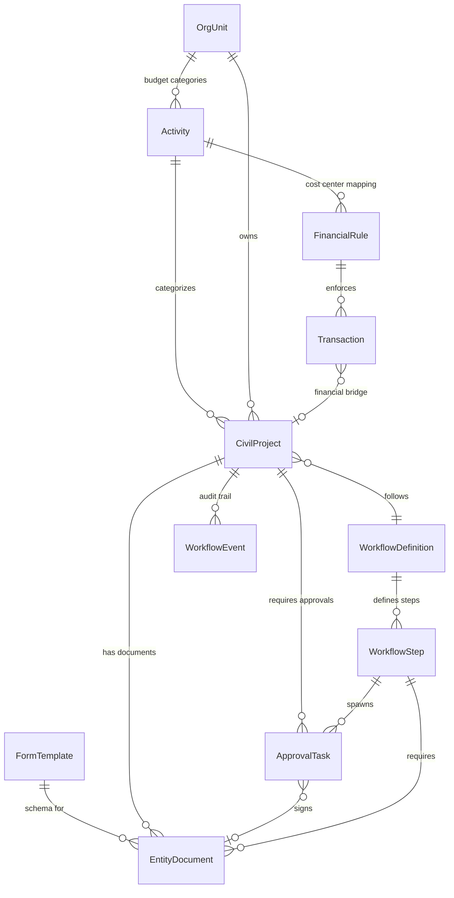

# Civil Engineering Module — Architectural Review

## Executive Summary

Your proposed **Core + Payload** architecture is fundamentally sound and is, in fact, the dominant pattern used by mature ERP/BPMS systems (SAP's `BSEG`/`CDPOS`, Odoo's `ir.attachment` + `mail.activity`, Microsoft Dynamics' Entity framework). You're on the right track. This review provides the engineering detail to execute it correctly against your existing codebase.

---

## 1. Does the "Core + Payload" Hybrid Make Sense?

**Yes — emphatically.** Here's why it works for your specific situation:

### What You Already Have (Your Strengths)

Your existing Financial Matrix is **exactly** the rigid core that should remain untouched:

```
OrgUnit ──→ Activity ──→ FinancialRule ──→ Transaction ──→ TransactionAllocation
                              │
                       cost_center_code
                       budget_line_code
                       financial_event_type
```

Your `CivilProject` already correctly links to `OrgUnit` and `Activity`, inheriting the financial rules. This is the right foundation.

### The Hybrid Split

| Layer | Responsibility | Change Frequency | Schema Stability |
|---|---|---|---|
| **Financial Core** | Ledger integrity, budget enforcement, audit trail | Rarely | Rigid — migrations only |
| **Workflow Engine** | State transitions, role-gated approvals | Per-department onboarding | Semi-rigid — DB-driven rules |
| **Document Payload** | Form data, generated PDFs, attachments | Per-step, per-form revision | Flexible — JSON + file storage |

This 3-layer separation means:
- **Layer 1** (your existing `Transaction`/`FinancialRule`) never changes when Civil Engineering adds a new form template
- **Layer 2** (new `WorkflowDefinition`/`ApprovalTask` tables) changes only when a department defines a new process
- **Layer 3** (new `EntityDocument` table with JSONB payload) changes freely without migrations

### The Critical Bridge

The moment a workflow step has financial implications (e.g., Step 8 = "Contract Committed", Step 22 = "Invoice Approved"), the Document Engine **emits a financial event** that creates a `Transaction` record. This is the bridge:

```
CivilProject.current_step → triggers ApprovalTask completion
    → Document payload validated
    → Financial event emitted → Transaction created
    → FinancialRule enforces budget_line / cost_center
```

> [!IMPORTANT]
> The Document Engine should **never write directly** to `Transaction`. Always go through a `FinancialEventService` that enforces `FinancialRule` lookup. This preserves the integrity of your existing matrix.

---

## 2. Major Pitfalls to Avoid

### Pitfall 1: The "God JSONB" Anti-Pattern

**Problem:** Storing everything in a single `JSONB` column with no schema enforcement leads to data rot within 6 months. Different form versions will have incompatible payloads.

**Solution: Versioned Form Schemas**

```python
class FormTemplate(Base):
    """Registry of all known form types across all departments."""
    __tablename__ = "form_templates"

    id = Column(Integer, primary_key=True)
    code = Column(String(64), unique=True, nullable=False, index=True)
    # e.g., "CIVIL_LAND_HANDOVER", "CIVIL_INVOICE_COVER"
    department = Column(String(64), nullable=False, index=True)
    # e.g., "CIVIL_ENGINEERING", "PARKS", "TRAFFIC"
    title = Column(String(255), nullable=False)
    title_fa = Column(String(255), nullable=False)  # Persian title
    version = Column(Integer, nullable=False, default=1)
    json_schema = Column(JSONB, nullable=False)
    # JSON Schema (draft-07) defining the expected payload structure
    is_active = Column(Boolean, nullable=False, default=True)
    created_at = Column(DateTime, default=datetime.utcnow)

    __table_args__ = (
        UniqueConstraint("code", "version", name="uq_form_template_code_version"),
    )


class EntityDocument(Base):
    """A filled-out form instance attached to a project at a specific step."""
    __tablename__ = "entity_documents"

    id = Column(Integer, primary_key=True)
    uuid = Column(UUID(as_uuid=True), default=uuid4, unique=True, nullable=False)

    # Polymorphic owner — works for CivilProject, future ParkProject, etc.
    entity_type = Column(String(64), nullable=False, index=True)
    # e.g., "civil_project"
    entity_id = Column(Integer, nullable=False, index=True)

    form_template_id = Column(
        Integer, ForeignKey("form_templates.id"), nullable=False
    )
    form_version = Column(Integer, nullable=False)
    # Snapshot of which version was used

    workflow_step = Column(Integer, nullable=True)
    # Which step this doc was created at (null = ad-hoc attachment)

    payload = Column(JSONB, nullable=False)
    # The actual form data — validated against FormTemplate.json_schema

    status = Column(
        SAEnum("DRAFT", "PENDING_SIGNATURES", "SIGNED", "SUPERSEDED", name="doc_status"),
        nullable=False,
        default="DRAFT",
    )

    pdf_storage_path = Column(String(512), nullable=True)
    # Path to the generated PDF (local or S3/MinIO)

    created_by_id = Column(Integer, ForeignKey("users.id"), nullable=False)
    created_at = Column(DateTime, default=datetime.utcnow, nullable=False)
    updated_at = Column(DateTime, default=datetime.utcnow, onupdate=datetime.utcnow)

    __table_args__ = (
        Index("ix_entity_doc_owner", "entity_type", "entity_id"),
        Index("ix_entity_doc_step", "entity_type", "entity_id", "workflow_step"),
    )
```

> [!TIP]
> **Validate payloads in the service layer**, not the database. Use Python's `jsonschema` library to validate `payload` against `FormTemplate.json_schema` before INSERT. This gives you clear error messages in Persian for your users while keeping the DB layer clean.

### Pitfall 2: Approval Tasks Without Deadlines or Delegation

**Problem:** Tasks get stuck forever. In a municipality, people go on vacation, get transferred, or simply forget.

**Solution: Time-bound tasks with escalation and delegation**

```python
class ApprovalTask(Base):
    """A single approval action required from a specific role/user."""
    __tablename__ = "approval_tasks"

    id = Column(Integer, primary_key=True)
    uuid = Column(UUID(as_uuid=True), default=uuid4, unique=True, nullable=False)

    # What entity needs approval
    entity_type = Column(String(64), nullable=False, index=True)
    entity_id = Column(Integer, nullable=False, index=True)
    workflow_step = Column(Integer, nullable=False)

    # Who must approve
    required_role = Column(
        SAEnum(CivilProjectRole, name="civil_project_role", create_type=False),
        nullable=False, index=True,
    )
    assigned_user_id = Column(
        Integer, ForeignKey("users.id"), nullable=True, index=True
    )
    # NULL = any user with the role can claim it

    # Approval group (for commission-style multi-sign)
    group_id = Column(UUID(as_uuid=True), nullable=True, index=True)
    # All tasks with the same group_id must be completed for the step to advance
    group_strategy = Column(
        SAEnum("ALL", "MAJORITY", "ANY", name="approval_strategy"),
        nullable=False,
        default="ALL",
    )

    # State
    status = Column(
        SAEnum("PENDING", "APPROVED", "REJECTED", "DELEGATED", "EXPIRED",
               name="approval_status"),
        nullable=False,
        default="PENDING",
        index=True,
    )
    decision_comment = Column(Text, nullable=True)
    decided_by_id = Column(Integer, ForeignKey("users.id"), nullable=True)
    decided_at = Column(DateTime, nullable=True)

    # Deadlines
    due_date = Column(DateTime, nullable=True)
    escalation_after = Column(DateTime, nullable=True)
    escalated_to_id = Column(Integer, ForeignKey("users.id"), nullable=True)

    # Delegation chain
    delegated_from_id = Column(Integer, ForeignKey("users.id"), nullable=True)

    created_at = Column(DateTime, default=datetime.utcnow, nullable=False)

    __table_args__ = (
        Index("ix_approval_inbox", "required_role", "status"),
        Index("ix_approval_entity", "entity_type", "entity_id", "workflow_step"),
    )
```

### Pitfall 3: Missing the Audit Trail

**Problem:** Municipal projects are audited by the Audit Court (دیوان محاسبات). Every state change, every signature, every document revision must be traceable.

**Solution: Event Sourcing for the workflow log**

```python
class WorkflowEvent(Base):
    """Immutable audit log — append-only, never UPDATE or DELETE."""
    __tablename__ = "workflow_events"

    id = Column(Integer, primary_key=True)
    entity_type = Column(String(64), nullable=False, index=True)
    entity_id = Column(Integer, nullable=False, index=True)

    event_type = Column(String(64), nullable=False)
    # e.g., "STEP_ADVANCED", "DOCUMENT_SIGNED", "TASK_DELEGATED",
    #       "APPROVAL_GRANTED", "APPROVAL_REJECTED", "FINANCIAL_EVENT_EMITTED"

    from_step = Column(Integer, nullable=True)
    to_step = Column(Integer, nullable=True)

    actor_id = Column(Integer, ForeignKey("users.id"), nullable=False)
    actor_role = Column(String(64), nullable=False)
    actor_ip = Column(String(45), nullable=True)  # IPv4/IPv6

    metadata = Column(JSONB, nullable=True)
    # Flexible: approval_task_id, document_id, transaction_id, comment, etc.

    timestamp = Column(DateTime, default=datetime.utcnow, nullable=False, index=True)

    __table_args__ = (
        Index("ix_workflow_event_entity", "entity_type", "entity_id", "timestamp"),
    )
```

> [!CAUTION]
> **Never add UPDATE/DELETE operations on `workflow_events`.** Mark this table as append-only in your ORM. Use PostgreSQL row-level security or a trigger to enforce immutability in production.

### Pitfall 4: File Storage in the Database

**Problem:** Storing PDFs as BLOBs will bloat your PostgreSQL WAL and kill backup performance.

**Solution:**
- Store files on **MinIO** (S3-compatible, self-hosted, free) or even a simple NFS mount
- Store only the `storage_path` in `EntityDocument.pdf_storage_path`
- Use a `FileStorageService` abstraction so you can swap backends later

### Pitfall 5: N+1 Queries on the Project Timeline

**Problem:** Loading a project's full history (31 steps × documents × approval tasks) will create massive query fans.

**Solution:** PostgreSQL-specific optimizations:

```sql
-- Composite index for the "project timeline" view
CREATE INDEX ix_entity_doc_timeline
ON entity_documents (entity_type, entity_id, workflow_step, created_at DESC);

-- Partial index for pending approvals (the most queried state)
CREATE INDEX ix_approval_pending
ON approval_tasks (required_role, entity_type, entity_id)
WHERE status = 'PENDING';
```

In SQLAlchemy, use `selectinload` (not `joinedload`) for the one-to-many relationships to avoid Cartesian explosions:

```python
project = (
    db.query(CivilProject)
    .options(
        selectinload(CivilProject.documents),
        selectinload(CivilProject.approval_tasks)
            .selectinload(ApprovalTask.decided_by),
    )
    .get(project_id)
)
```

---

## 3. How to Model the State Machine

### Recommendation: **Database-Driven Rules + Application Guard Rails**

Neither pure hardcoding nor a full external workflow engine is right for you. Here's why:

| Approach | Verdict | Reason |
|---|---|---|
| ❌ Hardcoded in Python | Too rigid | Your employer explicitly wants scalability to other departments. Hardcoding Civil Engineering's 31 steps means rewriting for Parks, Traffic, etc. |
| ❌ Full workflow engine (Camunda, Airflow) | Overkill | Adds massive operational complexity. You'd need to deploy/maintain a JVM or Go service, handle its own state, and sync with your existing PostgreSQL. |
| ✅ **DB-Driven transition rules** | Right balance | Department heads can (eventually) configure workflows via admin UI. Your app code provides the guard rails and financial hooks. |

### The Transition Table Design

```python
class WorkflowDefinition(Base):
    """A reusable workflow template (e.g., 'Civil Engineering Project Lifecycle')."""
    __tablename__ = "workflow_definitions"

    id = Column(Integer, primary_key=True)
    code = Column(String(64), unique=True, nullable=False)
    # e.g., "CIVIL_PROJECT_LIFECYCLE"
    title = Column(String(255), nullable=False)
    department = Column(String(64), nullable=False, index=True)
    total_steps = Column(Integer, nullable=False)
    total_phases = Column(Integer, nullable=False)
    is_active = Column(Boolean, nullable=False, default=True)

    steps = relationship("WorkflowStep", back_populates="definition",
                         order_by="WorkflowStep.step_number")


class WorkflowStep(Base):
    """Defines a single step within a workflow."""
    __tablename__ = "workflow_steps"

    id = Column(Integer, primary_key=True)
    definition_id = Column(
        Integer, ForeignKey("workflow_definitions.id", ondelete="CASCADE"),
        nullable=False, index=True,
    )
    step_number = Column(Integer, nullable=False)
    phase_number = Column(Integer, nullable=False)
    title = Column(String(255), nullable=False)
    title_fa = Column(String(255), nullable=False)
    description = Column(Text, nullable=True)

    # What documents are required at this step?
    required_form_codes = Column(ARRAY(String), nullable=True)
    # e.g., ["CIVIL_LAND_HANDOVER", "CIVIL_COMMISSION_APPROVAL"]

    # What approvals are needed to exit this step?
    required_approval_roles = Column(ARRAY(String), nullable=True)
    # e.g., ["CIVIL_MANAGER", "SUPERVISOR"]
    approval_strategy = Column(
        SAEnum("ALL", "MAJORITY", "ANY", name="approval_strategy",
               create_type=False),
        nullable=False, default="ALL",
    )

    # Does this step trigger a financial event?
    financial_event_type = Column(String(128), nullable=True)
    # e.g., "BUDGET_BLOCKED", "CONTRACT_COMMITTED", "INVOICE_APPROVED"
    # NULL = no financial implication

    # Can this step be skipped under certain conditions?
    is_skippable = Column(Boolean, nullable=False, default=False)
    skip_condition = Column(JSONB, nullable=True)
    # e.g., {"if": "project.contract_type == 'SMALL_PURCHASE'"}

    # Transition rules
    on_complete_go_to = Column(Integer, nullable=True)
    # Usually step_number + 1, but allows branching
    on_reject_go_to = Column(Integer, nullable=True)
    # Usually previous step or a correction loop

    definition = relationship("WorkflowDefinition", back_populates="steps")

    __table_args__ = (
        UniqueConstraint("definition_id", "step_number",
                         name="uq_workflow_step_number"),
    )
```

### The State Machine Service (Guard Rails)

```python
class CivilWorkflowService:
    """Enforces transition rules — the 'guard rails' around the DB-driven state machine."""

    def __init__(self, db: Session):
        self.db = db

    def advance_project(
        self,
        project: CivilProject,
        actor_id: int,
        actor_role: str,
    ) -> CivilProject:
        # 1. Load the current step definition
        step_def = self._get_step_definition(project)

        # 2. Check: are all required documents submitted and signed?
        self._assert_documents_complete(project, step_def)

        # 3. Check: are all required approvals granted?
        self._assert_approvals_complete(project, step_def)

        # 4. If this step has a financial event, emit it
        if step_def.financial_event_type:
            self._emit_financial_event(project, step_def)

        # 5. Determine next step (may branch based on conditions)
        next_step = step_def.on_complete_go_to or (step_def.step_number + 1)
        next_phase = self._resolve_phase(project, next_step)

        # 6. Transition
        old_step = project.current_step
        project.current_step = next_step
        project.current_phase = next_phase
        project.updated_at = datetime.utcnow()

        # 7. Spawn approval tasks for the NEW step
        new_step_def = self._get_step_definition(project)
        self._spawn_approval_tasks(project, new_step_def)

        # 8. Log the event (immutable audit trail)
        self._log_event(project, "STEP_ADVANCED", old_step, next_step, actor_id, actor_role)

        self.db.commit()
        return project
```

### How This Maps to Your Existing Pattern

Your existing `WorkflowService` in [workflow_service.py](file:///h:/Freelancing_Project/KalaniProject/municipality_demo/app/services/workflow_service.py) uses a `TRANSITION_MAP` dict — which is essentially a hardcoded state machine. The DB-driven approach is the **same pattern** but with the transitions stored in `workflow_steps` instead of a Python dict:

```python
# CURRENT (funding workflow — hardcoded, fine for a simple linear flow)
TRANSITION_MAP: dict[S, dict[str, tuple[UserRole, S]]] = {
    S.PENDING_VP_PLANNING: {
        "approve": (UserRole.VP_PLANNING, S.PENDING_VP_FINANCE_REVIEW),
        ...
    }
}

# PROPOSED (civil engineering — DB-driven, scales to any department)
# WorkflowStep rows in the database serve the same purpose,
# but are configurable without code changes.
```

> [!NOTE]
> **You don't need to refactor the existing `WorkflowService`** for funding requests. That linear flow works fine with a hardcoded map. The DB-driven approach is for the **new** Civil Engineering module and future departments with complex, branching workflows.

---

## 4. Recommended Architecture (Complete Picture)

### Entity-Relationship Diagram



### Linking CivilProject to the Workflow Engine

Add a FK to `WorkflowDefinition` on your existing `CivilProject`:

```python
# In civil.py — add this column to CivilProject
workflow_definition_id = Column(
    Integer,
    ForeignKey("workflow_definitions.id", ondelete="RESTRICT"),
    nullable=True,  # nullable for backward compat with existing data
    index=True,
)
```

### The New Table Inventory

| Table | Purpose | Estimated Row Growth |
|---|---|---|
| `workflow_definitions` | Template registry | ~5 rows (one per department) |
| `workflow_steps` | Step definitions | ~150 rows (31 × 5 departments) |
| `form_templates` | Form schema registry | ~50 rows (16+ forms × departments) |
| `entity_documents` | Filled form instances | High — ~50 docs per project |
| `approval_tasks` | Approval assignments | High — ~100 tasks per project |
| `workflow_events` | Immutable audit log | Very high — append-only |

### PostgreSQL-Specific Recommendations

1. **Use `JSONB` not `JSON`** for `payload` and `metadata` columns — it's indexable via GIN:
   ```sql
   CREATE INDEX ix_entity_doc_payload ON entity_documents USING GIN (payload);
   ```

2. **Partition `workflow_events`** by month after ~1M rows:
   ```sql
   CREATE TABLE workflow_events (
       ...
   ) PARTITION BY RANGE (timestamp);
   ```

3. **Use PostgreSQL Advisory Locks** for step transitions to prevent concurrent double-advances:
   ```python
   # In CivilWorkflowService.advance_project()
   db.execute(text("SELECT pg_advisory_xact_lock(:lock_key)"),
              {"lock_key": project.id})
   ```

4. **Use `ARRAY` columns** (PostgreSQL-specific) for `required_form_codes` and `required_approval_roles` — much cleaner than junction tables for small, fixed lists.

---

## Phased Implementation Roadmap

### Phase 1: Foundation (Week 1-2)
- [ ] Create Alembic migrations for `workflow_definitions`, `workflow_steps`, `form_templates`
- [ ] Seed the 31-step Civil Engineering workflow definition
- [ ] Add `workflow_definition_id` FK to `CivilProject`
- [ ] Create `CivilWorkflowService` with basic `advance_project()` logic

### Phase 2: Document Engine (Week 3-4)
- [ ] Create `entity_documents` table + `EntityDocument` model
- [ ] Build JSON Schema definitions for the 16+ form templates
- [ ] Create `DocumentService` (validate payload, store, generate PDF)
- [ ] Integrate PDF generation (WeasyPrint or wkhtmltopdf — you already have the installer)
- [ ] Build React dynamic form renderer (driven by `FormTemplate.json_schema`)

### Phase 3: Approval Engine (Week 5-6)
- [ ] Create `approval_tasks` table + `ApprovalTask` model
- [ ] Create `ApprovalService` (spawn tasks, process decisions, check completion)
- [ ] Build React approval inbox component
- [ ] Implement digital signature capture (simple: role-authenticated click with timestamp + IP logging)

### Phase 4: Financial Bridge (Week 7-8)
- [ ] Create `FinancialEventService` that bridges `WorkflowStep.financial_event_type` → `Transaction`
- [ ] Wire financial gates: Budget Blocked (Step ~4), Contract Committed (Step ~8), Invoice Approved (Step ~22)
- [ ] Create `workflow_events` table for full audit trail

### Phase 5: Polish & Scalability (Week 9-10)
- [ ] Build admin UI for workflow definition management
- [ ] Add deadline/escalation background job (Celery or APScheduler)
- [ ] Create the second department workflow (e.g., Parks) to validate scalability
- [ ] Performance testing with realistic data volumes

---

## Key Design Decisions Summary

| Decision | Recommendation | Rationale |
|---|---|---|
| Form storage | JSONB payload + JSON Schema validation | Avoids schema explosion; forms can evolve without migrations |
| State machine | DB-driven rules in `workflow_steps` | Scales to new departments without code changes |
| Approval routing | Dedicated `approval_tasks` table with group support | Handles both single-sign and commission (multi-sign) patterns |
| File storage | External (MinIO/filesystem) + path in DB | Prevents DB bloat; enables CDN serving |
| Audit trail | Append-only `workflow_events` | Audit Court compliance; enables full timeline reconstruction |
| Financial bridge | Event-based: step completion → `FinancialEventService` → `Transaction` | Decouples workflow from ledger; preserves Financial Matrix integrity |
| Existing `WorkflowService` | Leave as-is | Linear funding flow doesn't need the new engine's complexity |

> [!WARNING]
> **The biggest risk is scope creep.** The employer wants "everything in one system," but resist the urge to build email, chat, or a full DMS. Build the approval inbox, document attachment, and PDF generation — then stop. Integration with existing systems (if any) should happen via API bridges, not by absorbing their functionality.
