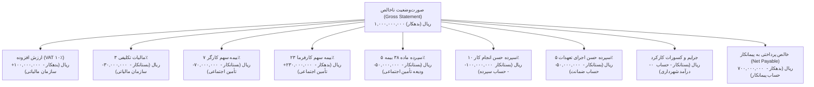
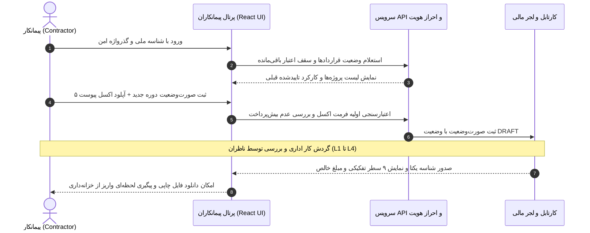
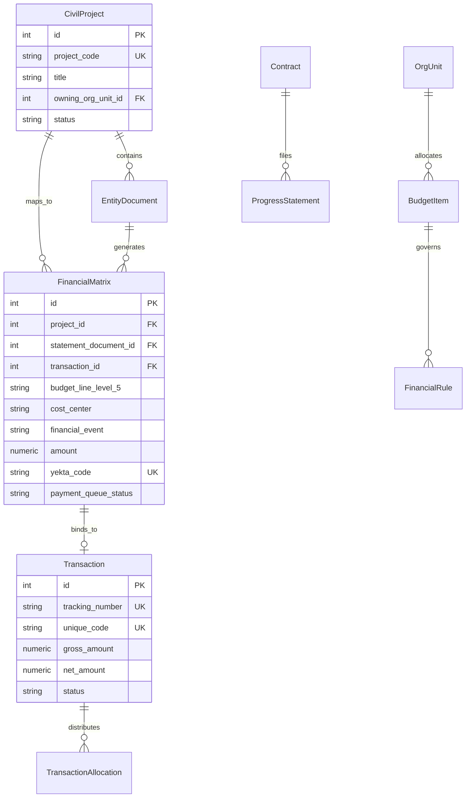

<div dir="rtl">

# مرجع جامع مهندسی: شناسه یکتا (کد یکتا)، فرآیند صورت‌وضعیت پیمانکاران و نقش اداره امور پیمانکاران
### سامانه مدیریت فرآیندهای مالی و پروژه‌های شهرداری اصفهان (Municipality BPMS & Yekta Code System)

---

## ۱. مقدمه و چرایی ایجاد سیستم (Problem Statement & Philosophy)

در سازمان‌های بزرگ خدماتی و دولتی نظیر شهرداری‌ها با ده‌ها منطقه، سازمان تابعه، معاونت و صدها ردیف بودجه، مدیریت تراکنش‌های مالی یکی از پیچیده‌ترین چالش‌های حاکمیتی و مهندسی نرم‌افزار است. پیش از استقرار این سامانه:

* **جزیره‌ای بودن سیستم‌ها:** واحدهای اجرایی (عمران، خدمات شهری، فضای سبز)، امور پیمانکاران، کارگزینی و اداره کل امور مالی هر کدام از سامانه‌ها و دفاتر مجزایی استفاده می‌کردند.
* **خطاهای محاسباتی در کسورات:** محاسبات دستی مالیات ماده ۱۰۴، بیمه ماده ۳۸ تأمین اجتماعی، سپرده‌های حسن انجام کار و جرایم تاخیر، ماهانه میلیاردها ریال عدم‌تطابق مالی ایجاد می‌کرد.
* **فقدان ردگیری جامع (Audit Trail):** مشخص نبودن این‌که یک صورت‌وضعیت دقیقاً در کدام کارتابل یا مرحله از نردبان تصویب قرار دارد و منشأ اعتباری آن کدام ردیف بودجه مصوب شورای شهر است.
* **ریسک اضافه پرداخت (Overpayment):** احتمال تکرار پرداخت یا صدور چندباره سند برای یک کارکرد یکسان پیمانکار.

**شناسه یکتای ۱۱ بخشی (Yekta Code)** به‌منزله **«DNA و شناسنامه مالی تغییرناپذیر»** طراحی شد تا تضمین کند هر ریال پرداختی در شهرداری دارای پیوند متقابل (Referential Integrity) با ردیف بودجه، مرکز هزینه، پیمانکار مشخص و رویداد مالی تفکیک‌شده باشد.

---

## ۲. کالبدشکافی فنی و الگوریتمی شناسه یکتا (11-Segment Architecture)

شناسه یکتا حاصل پیوند ۱۱ قطعه داده‌ای ساختاریافته است که در سرویس `app/services/yekta_codes.py` و `app/services/yekta_service.py` پیاده‌سازی شده است:

```text
[منطقه] - [معاونت] - [قسمت] - [ردیف بودجه] - [مرکز هزینه] - [اقدام مستمر] - [هش فعالیت] - [هش ذینفع] - [نوع رویداد مالی] - [سال مالی] - [شماره سریال]
```

```mermaid
flowchart LR
    A["Zone<br>منطقه (۰۵)"] --> B["Dept<br>معاونت (۰۲)"]
    B --> C["Section<br>قسمت (۰۰۱)"]
    C --> D["Budget<br>ردیف بودجه (۲۱۱۱۰۱۰۱)"]
    D --> E["CostCenter<br>مرکز هزینه (۰۰۵)"]
    E --> F["Action<br>اقدام مستمر (۰۱)"]
    F --> G["ActHash<br>هش فعالیت (A4F)"]
    G --> H["BenefHash<br>هش پیمانکار (3B9F12)"]
    H --> I["Event<br>رویداد (۰۲۰)"]
    I --> J["Year<br>سال مالی (۱۴۰۳)"]
    J --> K["Seq<br>سریال (۰۰۱)"]
```



### تحلیل فنی و ساختار فیلدهای ۱۱گانه:

| شماره | نام سگمنت (Segment) | نوع و طول | کد پیش‌فرض | الگوریتم و عملکرد در کد منبع |
| :---: | :--- | :---: | :---: | :--- |
| **۱** | **منطقه (Zone)** | `String(2)` | `00` | کد دو رقمی منطقه شهرداری؛ با تابع `zero_fill_segment(code, 2)` با صفر چپ‌پر می‌شود (مثال: `05`). |
| **۲** | **معاونت (Department)** | `String(2)` | `00` | کد معاونت اداری متولی (مثال: `02` = خدمات شهری، `03` = عمران). |
| **۳** | **قسمت / اداره (Section)** | `String(3)` | `000` | کد سه‌رقمی اداره ناظر زیرمجموعه معاونت (مثال: `010` = اداره نظارت بر پیمان‌ها). |
| **۴** | **ردیف بودجه (Budget Line)** | `String(8)` | `00000000` | کد سطح ۵ بودجه مصوب شهرداری؛ مستقیماً به ردیف `BudgetItem` پیوند دارد (مثال: `21110101`). |
| **۵** | **مرکز هزینه (Cost Center)** | `String(3)` | `000` | کد مرکز هزینه مقصد مصرف بودجه در ماتریس مالی (مثال: `105`). |
| **۶** | **اقدام مستمر (Continuous Action)** | `String(2)` | `00` | کد فعالیت‌های روتین شهرداری (مثال: `01` = رفت‌وروب، `02` = لکه‌گیری آسفالت). |
| **۷** | **هش فعالیت (Special Activity Hash)** | `String(3)` | `000` | برش ۳ کاراکتری هش MD5 عنوان پروژه: `hashlib.md5(title).hexdigest()[:3].upper()`. |
| **۸** | **هش ذینفع (Beneficiary Hash)** | `String(6)` | `000000` | برش ۶ کاراکتری هش MD5 نام یا شناسه ملی پیمانکار/ذینفع (مثال: `3B9F12`). |
| **۹** | **کد رویداد مالی (Financial Event)** | `String(3)` | `000` | کد سه‌رقمی رویداد تفکیکی بر اساس جدول استاندارد رویدادهای شهرداری (مثال: `004`, `020`, `007`). |
| **۱۰** | **سال مالی (Fiscal Year)** | `String(4)` | `1403` | سال مالی خورشیدی جاری سامانه که از تقویم جلالی `jdatetime` استخراج می‌شود. |
| **۱۱** | **شماره سریال (Sequence)** | `String(3)` | `001` | شمارنده افزایشی ۳ رقمی مستقل به ازای هر پیشوند مشترک برای جلوگیری از تکرار کد. |

---

## ۳. ماتریس رویدادهای ۹‌گانه مالی و نحوه تفکیک محاسباتی صورت‌وضعیت

هنگامی که یک صورت‌وضعیت توسط پیمانکار ارائه و از سوی ناظران تأیید می‌شود، سامانه کل مبلغ را به ۹ سطر تفکیکی حسابداری خرد می‌کند (`MUNICIPALITY_FINANCIAL_EVENTS`). به هر سطر یک شناسه یکتای اختصاصی تعلق می‌گیرد:



### نمونه محاسباتی واقعی برای صورت‌وضعیت ۱,۰۰۰,۰۰۰,۰۰۰ ریالی (۱۰۰ میلیون تومان):

| ردیف | شناسه رویداد مالی | عنوان رویداد | نرخ/ضریب | ماهیت حساب | مبلغ (ریال) | ذینفع تسویه‌حساب | نمونه کد یکتای صادره |
| :---: | :--- | :--- | :---: | :---: | :---: | :--- | :--- |
| **۱** | `GROSS_STATEMENT` | ناخالص کارکرد پیمانکار | ۱۰۰٪ | بدهکار (DEBIT) | ۱,۰۰۰,۰۰۰,۰۰۰ | پیمانکار (ثبت هزینه) | `05-02-001-21110101-005-01-A4F-3B9F12-004-1403-001` |
| **۲** | `VALUE_ADDED_TAX` | مالیات بر ارزش افزوده | ۱۰٪ | بدهکار (DEBIT) | ۱۰۰,۰۰۰,۰۰۰ | سازمان امور مالیاتی | `05-02-001-21110101-005-01-A4F-TAXORG-020-1403-001` |
| **۳** | `TAX_WITHHOLDING` | مالیات تکلیفی علی‌الحساب | ۳٪ | بستانکار (CREDIT) | ۳۰,۰۰۰,۰۰۰ | سازمان امور مالیاتی | `05-02-001-21110101-005-01-A4F-TAXORG-020-1403-002` |
| **۴** | `EMPLOYEE_INSURANCE`| بیمه سهم پرسنل پیمانکار | ۷٪ | بستانکار (CREDIT) | ۷۰,۰۰۰,۰۰۰ | سازمان تأمین اجتماعی | `05-02-001-21110101-005-01-A4F-SSO001-020-1403-003` |
| **۵** | `EMPLOYER_INSURANCE`| حق بیمه سهم کارفرما | ۲۳٪ | بدهکار (DEBIT) | ۲۳۰,۰۰۰,۰۰۰ | سازمان تأمین اجتماعی | `05-02-001-21110101-005-01-A4F-SSO001-007-1403-001` |
| **۶** | `SOCIAL_SECURITY_DEPOSIT`| سپرده بیمه ماده ۳۸ | ۵٪ | بستانکار (CREDIT) | ۵۰,۰۰۰,۰۰۰ | ودیعه تأمین اجتماعی شهرداری | `05-02-001-21110101-005-01-A4F-SSODEP-007-1403-002` |
| **۷** | `RETENTION_GUARANTEE`| سپرده حسن انجام کار | ۱۰٪ | بستانکار (CREDIT) | ۱۰۰,۰۰۰,۰۰۰ | حساب سپرده امانی شهرداری | `05-02-001-21110101-005-01-A4F-MUNRET-008-1403-001` |
| **۸** | `PERFORMANCE_GUARANTEE`| حسن اجرای تعهدات | ۵٪ | بستانکار (CREDIT) | ۵۰,۰۰۰,۰۰۰ | حساب ضمانت‌نامه شهرداری | `05-02-001-21110101-005-01-A4F-MUNGUA-008-1403-002` |
| **۹** | `OTHER_DEDUCTIONS` | جرایم و کسورات تاخیر | متغیر | بستانکار (CREDIT) | ۰ | حساب جرایم پیمان‌های شهرداری | `05-02-001-21110101-005-01-A4F-MUNDED-099-1403-001` |
| **۱۰** | `NET_PAYABLE` | **خالص پرداختی به پیمانکار** | **فرمول** | **بدهکار (DEBIT)** | **۷۰۰,۰۰۰,۰۰۰** | **شماره شبای بانکی پیمانکار** | `05-02-001-21110101-005-01-A4F-3B9F12-010-1403-001` |

> **فرمول محاسبه خالص پرداختی به پیمانکار:**
> $$\text{Net Payable} = \text{Gross} - (\text{Tax Withholding} + \text{Employee Insurance} + \text{SS Deposit} + \text{Retention} + \text{Performance} + \text{Penalties})$$
> $$\text{Net Payable} = ۱,۰۰۰,۰۰۰,۰۰۰ - (۳۰,۰۰۰,۰۰۰ + ۷۰,۰۰۰,۰۰۰ + ۵۰,۰۰۰,۰۰۰ + ۱۰۰,۰۰۰,۰۰۰ + ۵۰,۰۰۰,۰۰۰ + ۰) = ۷۰۰,۰۰۰,۰۰۰ \text{ ریال}$$

---

## ۴. چرخه حیات صورت‌وضعیت در سه ماژول اصلی

این سامانه دارای ۳ خط فرآیندی مستقل و مکمل است:

### ۴.۱. فرآیند قراردادهای حجمی (Volume Contracts - گام‌های ۱۰۱ تا ۱۰۴)
1. **گام ۱۰۱ (قرارداد پایه - `VOLUME_BASE_STEP_NUMBER`):** ثبت شماره پیمان، موضوع، پیمانکار، تاریخ شروع و پایان و مبلغ اولیه.
2. **گام ۱۰۲ (بارگذاری صورت‌وضعیت و پیوست ۵ - `VOLUME_STATEMENT_STEP_NUMBER`):** آپلود فایل اکسل کارکرد ماهیانه و لیست حقوق و دستمزد پرسنل.
3. **گام ۱۰۳ (پیوند به ماتریس مالی - `VOLUME_YEKTA_STEP_NUMBER`):** انتخاب دقیق ردیف بودجه سطح ۵ و مرکز هزینه از درخت سازمانی.
4. **گام ۱۰۴ (صدور شناسه یکتا و انتقال به صف خزانه‌داری - `VOLUME_GENERATION_STEP_NUMBER`):** پردازش خودکار توسط `YektaService`، صدور کدهای ۱۱ بخشی و ایجاد رکورد `Transaction` با وضعیت `READY_FOR_PAYMENT_QUEUE`.

### ۴.۲. فرآیند پروژه‌های عمرانی (Civil Engineering BPMS - گام‌های ۱ تا ۳۳+)
* فرآیند جامع ۳۳ مرحله‌ای شامل تحویل زمین (`LAND_HANDOVER`)، صورتجلسات کمیسیون تحویل موقت (`COMMISSION_MINUTES`) و انتساب پیمانکار (`CONTRACTOR_ASSIGNMENT`).
* **گام ۳۳ (صورت‌وضعیت پیشرفت کار - `PROGRESS_STATEMENT`):** با اجرای پل مالی `CivilFinancialBridgeService`، پس از بررسی سقف اعتبار و نرخ خالص پرداخت ۸۵٪، سند به صورت خودکار به لجر مالی منتقل می‌شود.

### ۴.۳. فرآیند تطبیق حضور و غیاب و محاسبه جرایم (Attendance Reconciliation)
* **ورودی دوگانه:** دریافت فایل اکسل ۱۸ ستونی حضور و غیاب ثبت‌شده توسط حراست مناطق در برابر اکسل اعلامی پیمانکار (پیوست ۵).
* **موتور محاسبه ارزش قانونی کارکرد (`pricing_engine.py`):** محاسبه خودکار حقوق پایه ماهانه (۱۵۶,۰۹۶,۵۵۸ ریال)، مزایای ثابت (۲۶۰,۰۰۰,۰۰۰ ریال)، حق تاهل (۲۰,۰۰۰,۰۰۰ ریال)، حق اولاد، اضافه کار ساعتی (۱,۲۸۲,۷۷۵ ریال)، تعطیل‌کاری و جمعه‌کاری.
* **ثبت جرایم (`PenaltyRecord`):** مغایرت‌های مربوط به غیبت یا کسری نفر-ساعت به عنوان سطر جریمه کسر می‌شود.

---

## ۵. تعاملات پیمانکار با سامانه (Contractor Experience)



### مزایای مشخص برای پیمانکار:
1. **شفافیت بدون واسطه:** مشاهده تک‌تک ریال‌های کسر شده بابت بیمه، مالیات و سپرده‌ها.
2. **سند رسمی مالیاتی و تأمین اجتماعی:** کدهای یکتا در سامانه مودیان مالیاتی و شعب بیمه به عنوان شناسه تراکنش قطعی شهرداری مورد استناد است.
3. **عدم وابستگی به پیگیری حضوری:** اطلاع از قرارگیری سند در صف پرداخت بانک بدون نیاز به مراجعه به شهرداری مرکزی.

---

## ۶. وظایف و اختیارات اداره امور پیمانکاران و قراردادها (Contractors Department)

اداره امور پیمانکاران و قراردادها ستون فقرات نظارتی و کنترلی این سامانه است:

### ۱. تعریف قرارداد و کنترل سقف اعتبار (Ceiling Enforcement)
* اداره پیمان‌ها متولی ثبت مبلغ مصوب پیمان و ضرایب تعدیل است.
* سامانه اجازه نمی‌دهد مجموع صورت‌وضعیت‌های ثبت‌شده حتی ۱ ریال از سقف مجاز پیمان (با احتساب ۲۵٪ افزایش/کاهش مقادیر) تجاوز کند (`OverPaymentError`).

### ۲. مدیریت نردبان تاییدات ۴ سطحی (L1 to L4 Approval Ladder)
صورت‌وضعیت ارائه‌شده از مسیر زیر عبور می‌کند:
* **سطح ۱ (`PENDING_L1`):** بررسی و تایید احجام کار توسط مهندس ناظر مقیم پروژه.
* **سطح ۲ (`PENDING_L2`):** تایید رئیس اداره امور پیمانکاران منطقه/معاونت.
* **سطح ۳ (`PENDING_L3`):** تطبیق امور مالی و حسابداری منطقه.
* **سطح ۴ (`PENDING_L4`):** تایید مدیر مالی و صدور مجوز انتقال به خزانه‌داری.

### ۳. اعمال کنترل‌های انضباطی و تطبیق حراست
* اداره امور پیمانکاران گزارش‌های تطبیق حضور و غیاب حراست را بررسی کرده و در صورت گزارش غیبت یا کسری ماشین‌آلات، جرایم مربوطه را در قالب رویداد مالی `09` پیش از صدور کد یکتا اعمال می‌نماید.

---

## ۷. ساختار جداول پایگاه داده و مدل‌های ارتباطی (Data Architecture)



---

## ۸. جدول مقایسه‌ای: تحول فرآیندها

| بعد فرآیندی | روش سنتی پیشین | با استقرار سامانه شناسه یکتا |
| :--- | :--- | :--- |
| **هویت تراکنش** | نامه‌نگاری با شماره عطف‌های پراکنده و متغیر | شناسه ساختاریافته ۱۱ بخشی غیرقابل جعل و یکتا |
| **محاسبات بیمه و مالیات** | محاسبه دستی و احتمال خطای انسانی در اعمال ضرایب | محاسبه ماشینی اتوماتیک بر اساس ماتریس ۹گانه مالی |
| **انضباط بودجه‌ای** | خطر ثبت تعهدات بدون اعتبار و مازاد بر بودجه مصوب | قفل و رزرو لحظه‌ای بودجه قبل از صدور نهایی سند |
| **مدت زمان چرخه پرداخت** | بین ۳۰ تا ۹۰ روز کاری | کمتر از ۴۸ ساعت پس از تایید نهایی نردبان نظارت |
| **قابلیت ممیزی (Auditability)** | دشواری بازیابی فیزیکی پرونده‌ها در بازرسی‌های بعدی | ثبت ۱۰۰٪ دیجیتال با گزارش‌گیری آنی برای دستگاه‌های نظارتی |

</div>
